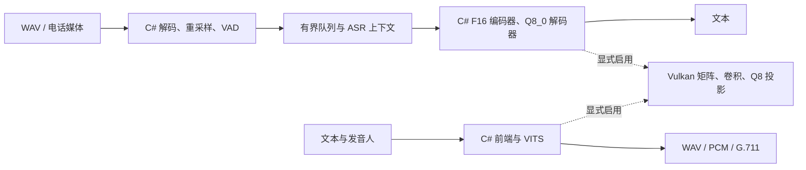

# 架构与纯 .NET 范围

核心 `FunAsrNet` 是 .NET 10 托管实现。ASR 读取 GGUF，执行滤波器组、Fun-ASR 编码器、Qwen3 解码器；TTS 读取固定 VITS ONNX，由自有解释器执行必要算子。它只支持已验证模型的算子子集，不是通用 ONNX Runtime 替代品。

## CPU 与精度

矩阵、量化、注意力、归一化、卷积、逐元素和布局转换由 C# 实现，根据硬件选择 SIMD/标量。F16 源权重按原值展开；Q8_0 保留权重与激活 32 元素分组，保留 F16 KV 舍入，不通过改变模型精度取得文档中的速度。

“纯 .NET”指不借外置神经网络推理引擎执行默认 CPU 算子，仍依赖 .NET、操作系统及普通平台 API。Windows x64 交错路径优化不完整，不能把 ARM64 SIMD 收益推广到全部平台。

## 可选 GPU

核心不引用 GPU 项目；调用者创建并释放 `VulkanFloatBackend`，首次推理前设置 `FloatBackend`。C# 管理缓存、传输、提交与栅栏；GPU 由系统驱动执行 SPIR-V。GLSL 源码和字节码嵌入 C#，运行时不需着色器编译器。

只加速部分算子，中间数据、剩余算子和部分权重仍在 CPU；不是完整图常驻或全链路零拷贝。Vulkan API/设备设施来自 SimdPaddleOCR，原许可在 Vendor 目录。`FUNASRNET_VULKAN_LIBRARY` 可设系统加载器绝对路径，默认用平台标准库名；不要硬编码某台机器的 DriverStore 路径。

## 会话与限制

模型实例的 KV、工作区、随机状态独立，权重只读共享；同一 `FunAsr`/`MandarinTts` 实例须串行使用。GPU 后端内部也串行保护命令状态。更多上下文不等于计算线性扩展，详见 [并发与内存](concurrency-and-memory.md)。

实时展示基于 VAD 与滑动预览，不是逐帧增量编码；NPU 只验证探针。TTS 尚未追平原生 ORT。多音字、人名、真实通话准确率及持续并发需业务语料验收。
