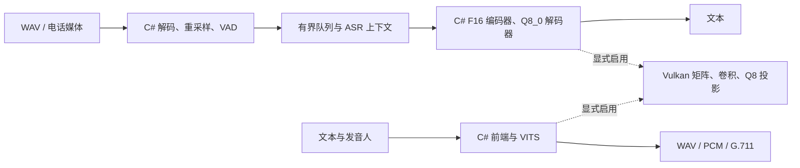

# 架构与纯 .NET 范围

核心 `FunAsrNet` 是 .NET 10 托管实现。ASR 读取 GGUF，执行滤波器组、Fun-ASR 编码器、Qwen3 解码器；TTS 读取固定 VITS ONNX，由自有解释器执行必要算子。它只支持已验证模型的算子子集，不是通用 ONNX Runtime 替代品。

## CPU 与精度

矩阵、量化、注意力、归一化、卷积、逐元素和布局转换由 C# 实现，根据硬件选择 SIMD/标量。F16 源权重按原值展开；Q8_0 保留权重与激活 32 元素分组，保留 F16 KV 舍入，不通过改变模型精度取得文档中的速度。

“纯 .NET”指不借外置神经网络推理引擎执行默认 CPU 算子，仍依赖 .NET、操作系统及普通平台 API。ASR 默认只在 ARM64 NEON/SDOT 可用时准备对应交错权重；x64 保留行主序，使用 AVX2/FMA 浮点矩阵和 AVX2/AVX-VNNI Q8 点积，避免进入 ARM 交错布局的标量回退。平台优化程度仍不一致，最新 x64 实测见 [本机 ASR 第五轮记录](cpu-round5-20261012.md)，前轮两端快照见 [纯 CPU 对比](cpu-native-comparison-20261012.md)。

x64 注意力使用 256 位分块和向量指数；TTS 转置卷积按采样相位计算，宽输出卷积使用八通道块。激活与卷积的浮点结果按独立参考和波形阈值验证，Q8 分组算术未改变。

x64 激活量化保留标量远离零舍入，Q8 投影按四行或四帧共同归约；FP32 矩阵使用完整块专用循环与 128 项内积分段。TTS 在所有权和引用次数允许时原地计算逐元素算子，详见 [缓冲区生命期与内存代价](concurrency-and-memory.md)。

x64 Q8 多投影共用输入量化与一次任务分派；FP32 完整四行块使用递进地址和双项展开，保留 K128 及 FMA 次序。F16 模型读取以向量精确展开。CPU TTS 可融合独占相邻卷积残差或激活，转置和多维填充避免逐元素高维索引；观察回调和可选后端继续使用原节点。

GGUF F16/Q8 读取使用有界池缓冲分块解包，避免保留整个源张量字节副本；Q8 的正规 Half 缩放直接展开位模式，特殊值沿用 .NET 转换。缩放和量化字节不重新量化；穷举全部 Half 位模式，并验证跨缓冲区边界和截断文件。加载计时与首次推理分别报告，见 [加载与 GPU 第六轮记录](load-gpu-round6-20261012.md)。

## 可选 GPU

核心不引用 GPU 项目；调用者创建并释放 `VulkanFloatBackend`，首次推理前设置 `FloatBackend`。C# 管理缓存、传输、提交与栅栏；GPU 由系统驱动执行 SPIR-V。GLSL 源码和字节码嵌入 C#，运行时不需着色器编译器。

`.comp` 通常是 GLSL 计算着色器源码，离线编译后的 `.spv` 是 SPIR-V 字节码，由 Vulkan 驱动提交给 GPU 执行。它与 .NET Native AOT 的 CPU 机器码不同，不能直接改善纯 CPU 推理。本项目对应源码为 `SpeechShader.cs`、`QuantizedShader.cs` 中的 GLSL 字符串，编译结果嵌入同名 `.Binary.cs`。可按 SimdPaddleOCR 的 Apache-2.0 许可参考或适配其实现，保留原许可、来源和改动说明；现有设备基础设施已这样引入。CPU 优化另行采用 C# SIMD，性能数据也分别测量。

只加速部分算子，中间数据、剩余算子和部分权重仍在 CPU；不是完整图常驻或全链路零拷贝。Vulkan API/设备设施来自 SimdPaddleOCR，原许可在 Vendor 目录。`FUNASRNET_VULKAN_LIBRARY` 可设系统加载器绝对路径，默认用平台标准库名；不要硬编码某台机器的 DriverStore 路径。

支持完整子组和 shuffle 的设备可用 `CooperativeQuantizedShader.cs`：八个通道并行读取一个 Q8_0 块，整数相加精确，保持原浮点分组累加次序。缺少特性自动使用原内核；`FUNASRNET_VULKAN_SUBGROUP_Q8=0` 可诊断回退。FP32 分块共享内存转置并填充，减少 bank 冲突及屏障次数，保持 FP32 FMA 路径。主机可见缓冲持久映射，传输屏障、栅栏和缓存刷新仍执行。

ONNX 动态 MatMul 和临时打包的转置卷积矩阵标记 `Weight.IsTransient`，Vulkan 使用可复用上传缓冲，避免每次申请长期显存缓存及额外上传提交；稳定模型权重仍有界驻留。此标记不改变 CPU 计算。新旧 GPU Q8 位结果、动态矩阵重复写入/扩容、完整 ASR 文本和 TTS 波形分别验证。

开发对照由 [FunAsrNet.Compare](../tools/FunAsrNet.Compare/README.md) 用 C# 串行编排。原 Python 脚本从当前版本移除；原始历史数据和来源 manifest 保留。

## 会话与限制

模型实例的 KV、工作区、随机状态独立，权重只读共享；同一 `FunAsr`/`MandarinTts` 实例须串行使用。GPU 后端内部也串行保护命令状态。更多上下文不等于计算线性扩展，详见 [并发与内存](concurrency-and-memory.md)。

实时展示基于 VAD 与滑动预览，不是逐帧增量编码；NPU 只验证探针。TTS 尚未追平原生 ORT。多音字、人名、真实通话准确率及持续并发需业务语料验收。
